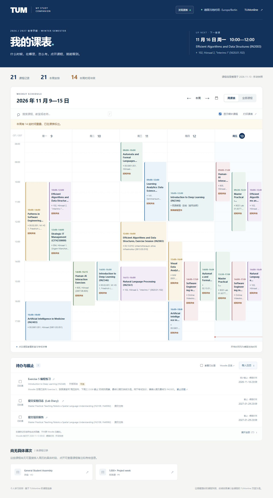

# Tum Timetable

A new login-ready personal timetable project, with deadline reminders, calendar export and a reusable 91-question bilingual NLP practice bank. Repository: `Tum-Timetable`.

**The public project starts with an empty timetable and no Moodle tasks. It does not include the owner's legacy personal course data.** Each account must have its own empty initial state; signing in must not copy another person's courses.

## Authentication status

The browser client and Node authentication backend are separate components. TUM SSO is **not available** until the university/identity provider approves the service registration and the server has the matching metadata, endpoints and certificates. Missing configuration must leave university login disabled. A login page or backend scaffold does not mean school login or data synchronization is connected.

SSO identifies a user; it does not by itself authorize TUMonline or Moodle data access. See the separate authentication documentation for the implementation and its required configuration.

## UI preview



Full-page desktop preview of the private edition, shown with the owner's permission; the new login edition starts with an empty timetable. Screenshot only; underlying personal data is excluded.

## Run locally

Use Node.js 22 or newer; CI uses Node.js 24.

```sh
npm ci
npm start
```

The Node server normally listens on port 3000 and serves the login entry and authenticated application from the same origin. Configure it according to the authentication docs before testing actual university login; the unconfigured state must stay disabled. Do not enter school passwords into this application.

```sh
npm test
npm run check
npm run build
npm run preview
```

`build` produces a **login-introduction-only static preview** in `dist/`: login HTML, authentication UI files, icons and the web manifest. It excludes the timetable, question bank, service worker, backend and account data. `preview` normally uses `http://127.0.0.1:4173`; it cannot authenticate anyone. `npm run dev` builds and serves the same restricted static preview. Use `npm start` or `npm run auth:start` for the backend integration.

## Project layout

```text
public/                  Browser source; protected pages remain for the backend
  data.js                Empty timetable state, never a shared account database
  courses/in2361/        Reusable bilingual practice bank and evidence figures
server/                  Separate authentication backend and its security tests
authoring/in2361/        Editable 91-question source and math renderer
scripts/                 Privacy checks and restricted static-preview builder
  legacy/                Archived private-edition PWA generator; disabled
tests/                  Content, backup and calendar compatibility tests
docs/                   Authentication, maintenance and deployment notes
.github/workflows/       CI and an optional manual login-preview Pages workflow
```

## Maintain the question bank

Edit `authoring/in2361/content.json`, preserving existing question IDs, then run:

```sh
npm run nlp:rebuild
npm test
```

This updates `public/courses/in2361/data.js` while preserving English/Chinese answers and source-review fields. The 91 stable IDs, backup format `nlp-study-backup` version `1`, course `IN2361`, and key `nlp-study-in2361-v1` remain compatible. A change of origin requires manual progress export/import; source migration cannot read another origin's browser storage. See [maintenance](docs/maintenance.md).

## Deployment and privacy

Deploy the configured Node backend to a server-capable host for a login application. GitHub Pages can only show the restricted static login introduction; it cannot run the backend, authenticate users or expose the protected application. The optional Pages workflow runs only on manual dispatch with an explicit preview confirmation. It does not enable Pages, create a repository or hardcode an owner.

Keep credentials, signing keys, session stores and account-specific timetables outside `public/`, the public repository and every PWA cache. The old private-edition offline generator is archived under `scripts/legacy/` and is not called by dev or build. This login edition does not promise offline access to private account data. See [deployment boundaries](docs/deployment.md).

## Materials

Reusable practice figures, selected source-page images and locally bundled KaTeX retain their existing notices. Complete original PDFs, Sites identity, Git history, credentials and personal progress exports are excluded. Source citations retain filenames and page numbers without links to a personal private site. No broad license for course materials is implied; review the included notices and provenance before reuse.

[中文使用说明](docs/usage.zh-CN.md) · [Maintenance](docs/maintenance.md) · [Deployment](docs/deployment.md)
