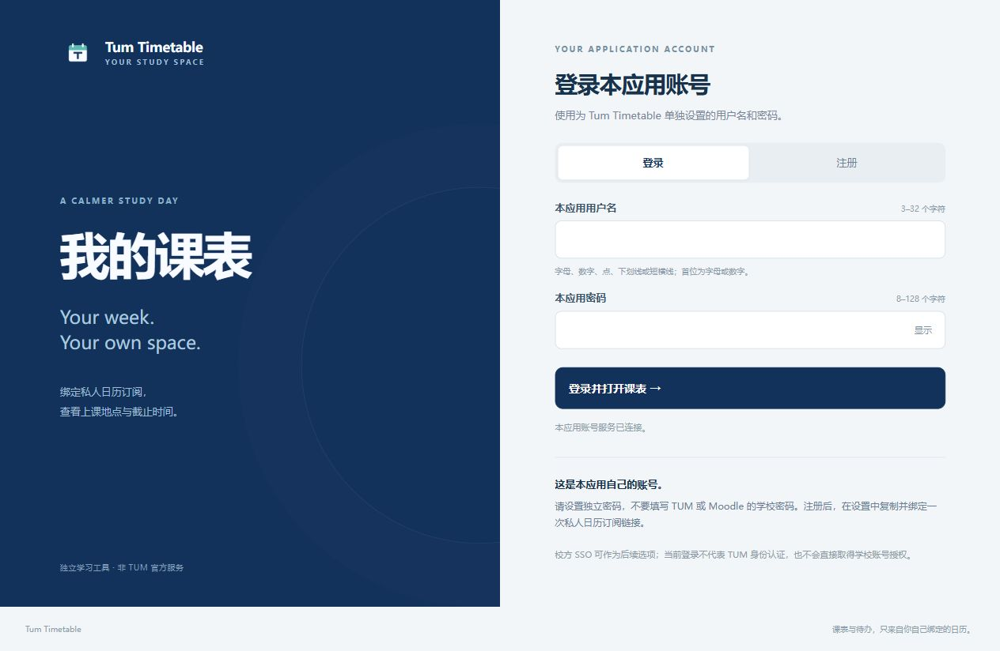
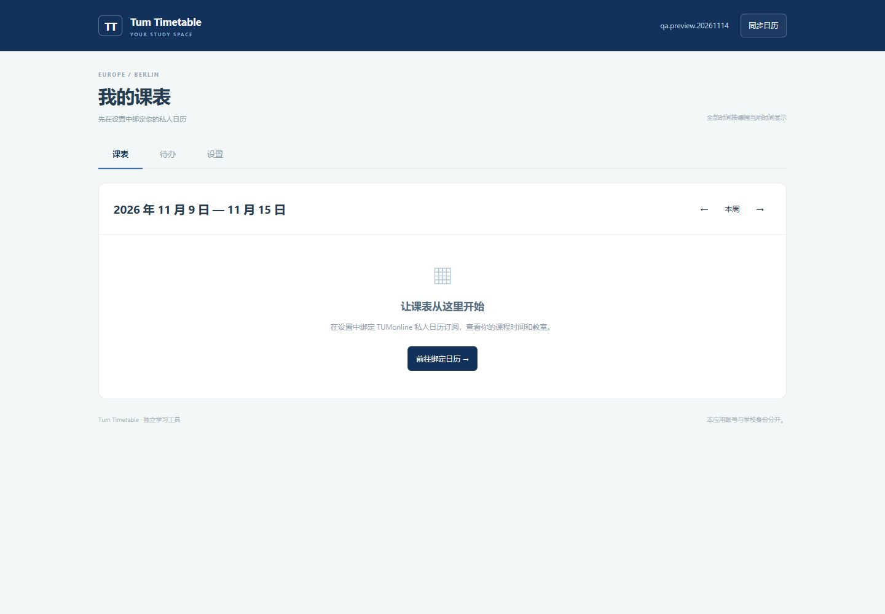

# Tum Timetable

Personal application accounts with private TUMonline and Moodle calendar subscriptions. New accounts start empty; the owner's old timetable and private links are not included.

**App:** [Open Tum Timetable](https://tum-timetable.chenmooo010701.chatgpt.site)

## Get started

1. Register a **Tum Timetable application account** with an independent password. This is not TUM identity verification; never enter your school password here.
2. In **Settings**, bind your private calendar links: **TUMonline → Calendar → Publish**, and **Moodle → Calendar → Export calendar → Get calendar URL**. Moodle export availability and date ranges depend on your account.
3. Paste each URL once and select **Bind and sync**. **Timetable** shows weekly times and locations; **Deadlines** shows the next five Moodle calendar activities. Accounts only see their own feeds.

Usernames are 3–32 ASCII letters/digits/dots/underscores/hyphens, starting with a letter or digit, and are normalized to lowercase. Application passwords are 8–128 Unicode characters and are not trimmed; uppercase letters and symbols are optional.

The app checks subscriptions on opening and every 15 minutes in the foreground; it checks stale data when returning to the foreground. **Closing it stops checks: there is no closed-app background polling.** Use Sync for an immediate refresh. Settings show the last successful sync and generic error state per source.

Private URLs are cleared from the input immediately, never written to browser storage or error messages, and encrypted by the account service. Possessing a subscription link grants calendar access; it is not direct school-account authorization.

Calendar export downloads courses and Moodle activities as ICS; Moodle activities carry one-day and two-hour reminders. Import it into your calendar app; that app's notification settings control the reminders. The downloaded file is a snapshot, so download it again after changes.

## Current application preview





The current app has **Timetable / Deadlines / Settings** navigation and begins without personal calendar data.

On Android, open the app in Chrome and choose **Install app** or **Add to Home screen**. The home-screen app follows website updates; private account data is not cached for offline access.

## Authorized private-edition preview


Full-page desktop preview of the private edition, shown with the owner's permission; the new login edition starts with an empty timetable. Screenshot only; underlying personal data is excluded. The existing private edition is maintained separately.

## Develop and verify

Use **Node.js 24 or newer**.

```sh
npm ci
npm start
```

The development server prints its HTTPS localhost URL, normally port 8781, uses a temporary local certificate, and stores development data in ignored `.local/`.

```sh
npm test
npm run check
npm run build
```

`build` bundles the APIs and seven browser UI files into `dist/server/index.js` for a Cloudflare-compatible Worker. Configure `APP_ORIGIN`, server secret `FEED_ENCRYPTION_KEY`, D1 binding `DB` and migrations as described in [application accounts](docs/auth-local.md) and [calendar binding](docs/calendar-binding.md). Never commit live secrets or databases.

GitHub Pages cannot run this backend. `npm run build:static` and the optional manual Pages workflow show only a login introduction, not a working account service. The private-edition PWA generator remains archived under `scripts/legacy/`; it is not enabled for account pages or private data.

## Scope and limitations

- Calendar events are **not grades, assessment rules, submission status or complete course materials**. External-platform deadlines may not appear.
- Successful synchronization does not prove that the source feed includes every course. Moodle export ranges can limit future coverage.
- The app uses its own accounts. School SAML remains a separate future option requiring university registration. `npm run auth:start` starts that optional integration, not the default app login.
- The deployed MVP does not link the retained NLP bank. Its 91 stable bilingual IDs, backup format/key compatibility and editable authoring tools remain in the repository; the existing private practice site is unchanged.

## Repository layout

```text
public/       Login/account UI; no personal timetable snapshot
server/       Accounts, sessions and calendar services
worker/       Worker entry and generated browser assets
db/,drizzle/  Database model and migrations
authoring/    Retained editable NLP source and math tools
scripts/      Build tools; archived legacy PWA helper
tests/        Front-end mock and compatibility tests
docs/         Setup, binding and maintenance notes
```

Complete original PDFs, school credentials, personal progress exports and private subscription URLs are excluded. Reusable course figures and KaTeX retain their attribution/license notices.

[中文使用说明](docs/usage.zh-CN.md) · [Account setup](docs/auth-local.md) · [Calendar details](docs/calendar-binding.md)
